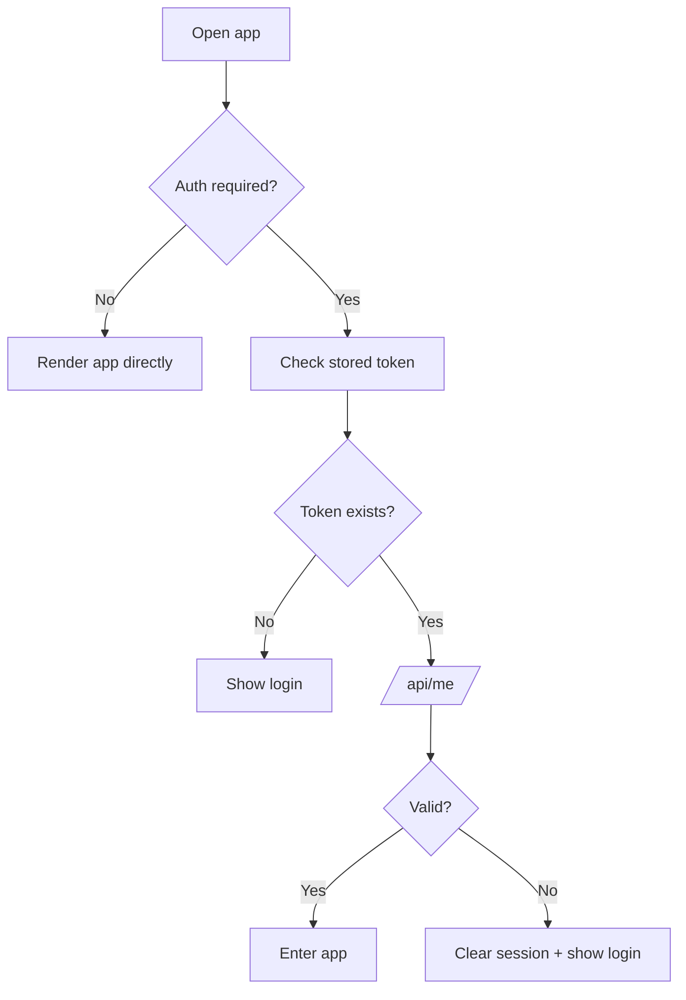
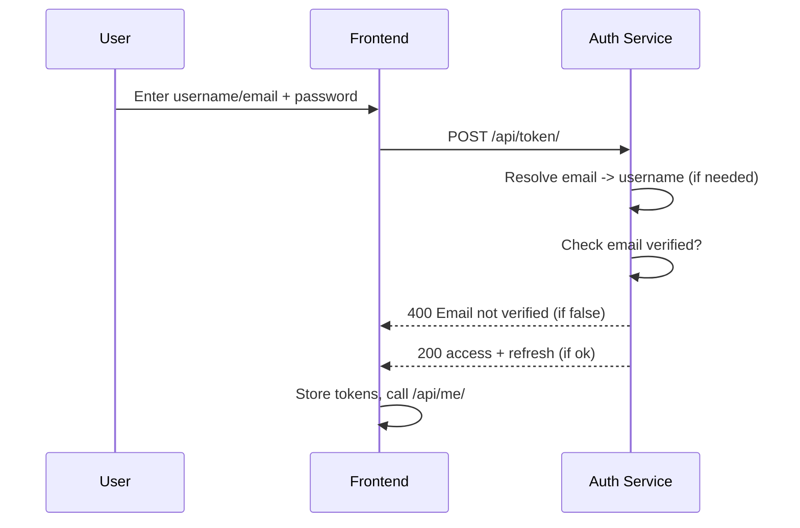
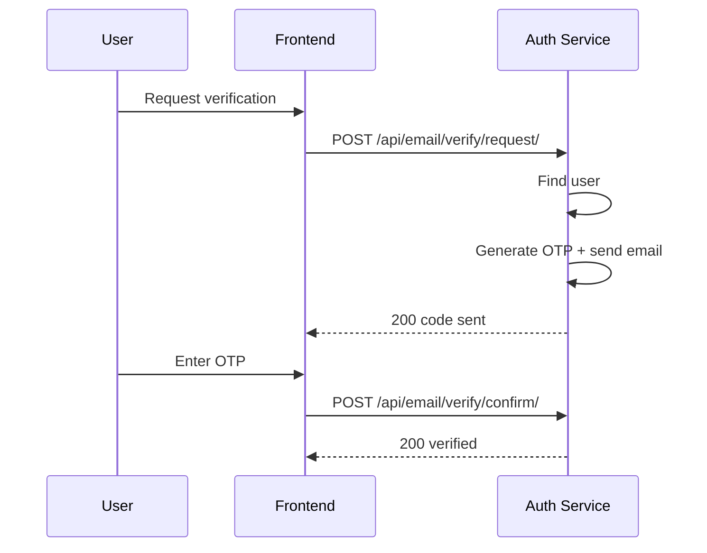
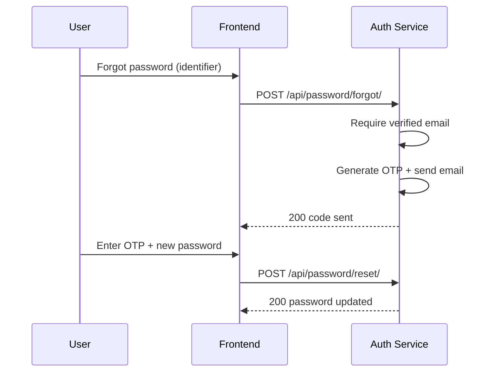

# Auth Flow (Corpus Medica)

This document explains the authentication and email verification flow in simple
steps. It also includes diagrams you can paste into docs or PRs.

## Components

- Frontend (Vite + React) running locally.
- Backend API (FastAPI) running in Docker.
- Auth service (Django + Postgres) running in Docker.
- SMTP provider for email delivery (Gmail or other).

## Environment Basics

Frontend reads `frontend/.env`:
- `VITE_API_BASE_URL`
- `VITE_AUTH_BASE_URL`
- `VITE_AUTH_REQUIRED=true`

Auth service reads `.env`:
- `SMTP_HOST`, `SMTP_PORT`, `SMTP_USER`, `SMTP_PASSWORD`, `SMTP_FROM_EMAIL`
- `SMTP_USE_TLS=true`, `SMTP_USE_SSL=false` (for Gmail)

## Endpoint Summary

- POST `AUTH_BASE/api/token/` -> login (username or email)
- GET `AUTH_BASE/api/me/` -> session check
- POST `AUTH_BASE/api/email/verify/request/` -> send verification code
- POST `AUTH_BASE/api/email/verify/confirm/` -> confirm verification
- POST `AUTH_BASE/api/password/forgot/` -> send reset code
- POST `AUTH_BASE/api/password/reset/` -> confirm reset

## Flow 1: App Boot + Session Check

1) App loads.
2) If auth is required, frontend checks for stored access token.
3) If a token exists, frontend calls `/api/me/`.
4) If valid, user enters the app.
5) If invalid, user is sent to login.

## Flow 2: Login (Username or Email)

1) User types username or email + password.
2) Frontend calls `/api/token/`.
3) Auth service resolves email -> username if needed.
4) If email is not verified, login is blocked.
5) If ok, tokens are returned and stored.

## Flow 3: Email Verification

1) User clicks "Verify email".
2) Frontend calls `/api/email/verify/request/`.
3) Auth sends OTP by email.
4) User enters OTP.
5) Frontend calls `/api/email/verify/confirm/`.
6) Auth marks the email as verified.

Notes:
- If the email is already verified, the server returns `already_verified=true`
  and the frontend returns to login.
- If the identifier is not found, the API responds with an error message.

## Flow 4: Forgot Password

1) User clicks "Forgot password".
2) Frontend calls `/api/password/forgot/`.
3) Auth sends OTP if the email is verified.
4) User submits OTP + new password to `/api/password/reset/`.
5) Password is updated.

## Admin Visibility

- Django admin shows whether the email is verified.
- Fields:
  - `Email verified` (boolean)
  - `Verified at` (timestamp)

## Common Troubleshooting

- No verification emails: check SMTP settings, use an app password for Gmail,
  and remove spaces from the password.
- Login blocked: verify email first.
- 401s from backend: make sure frontend env sets `VITE_AUTH_REQUIRED=true`.
