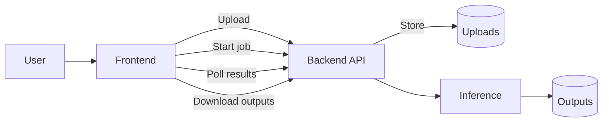
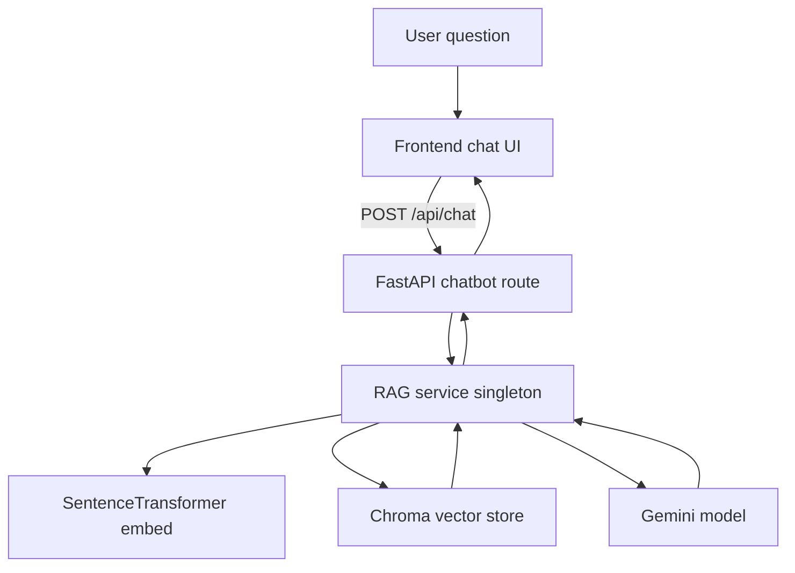

# Architecture

## High-level components
- Frontend: React + Vite + TypeScript
- Backend API: FastAPI + MONAI + PyTorch
- Auth service: Django + Postgres
- Storage: local filesystem for uploads, outputs, and model bundles
- Chatbot: RAG pipeline backed by Chroma and Gemini (Google SDK)

## Segmentation data flow

## Viewer data flow
- 2D slices: frontend requests PNG slices from `/api/uploads/slice`.
- 3D volume: frontend requests a NIfTI volume from `/api/uploads/volume-file`.
- 3D mesh: frontend requests a PLY mesh from `/api/uploads/mesh`.

## Chatbot data flow

Chatbot-specific notes:
- `get_chatbot()` lazily initializes the RAG pipeline on first request.
- If the vector store is empty, a background indexing thread starts and the response notes that sources are unavailable.
- Chroma persistence uses `CHROMA_PATH` when set, otherwise `backend/chroma_db` (if `chroma.sqlite3` exists) or `backend/chroma_storage`.

## Auth boundary
The backend enforces JWT auth for most endpoints. Exempt paths include:
- `/api/health`
- `/api/chat`, `/api/chat/health`, `/api/chat/stats`
- `/docs`, `/openapi.json`

## Storage layout
- `/data/uploads`: raw uploads
- `/data/outputs/<job_id>`: segmentation outputs
- `/data/tmp`: temporary conversions
- `/models/bundles`: MONAI bundles and weights
- `backend/chroma_db` or `backend/chroma_storage`: Chroma persistence

## Key backend modules
- `app/services/inference.py`: segmentation pipeline
- `app/services/models_registry.py`: bundle discovery and metadata
- `app/api/routes/uploads.py`: uploads and viewer IO
- `app/api/routes/segment.py`: job creation and polling
- `app/services/rag/chatbot.py`: Gemini RAG logic

## Key frontend modules
- `App.tsx`: main UI, viewers, workspace
- `ChatSidebar.tsx`: slide-in assistant
- `ChatPanel.tsx`: full chat panel
