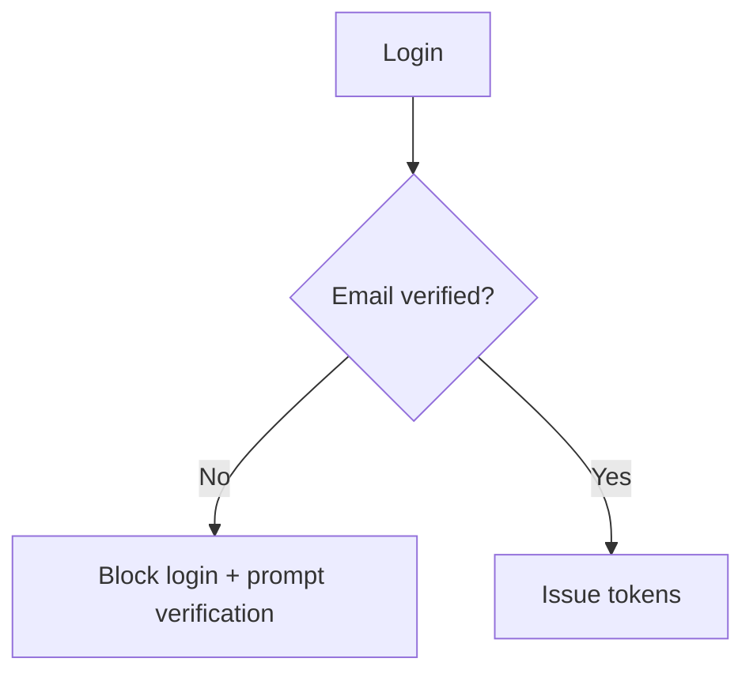

# Auth and Roles

Corpus Medica uses a dedicated Django auth service.

## Roles
- Developer: full control, can create admins and users.
- Admin: can create and manage users.
- User: standard access for clinicians.

## Key endpoints
- `POST /api/token/`: login (username or email)
- `GET /api/me/`: session check
- `POST /api/email/verify/request/`
- `POST /api/email/verify/confirm/`
- `POST /api/password/forgot/`
- `POST /api/password/reset/`

## Email verification
- Users must verify email before first login.
- Verification uses OTP over SMTP.

## Forgot password
- Requires a verified email.
- Uses OTP to confirm the reset.

## Admin setup
Create the first developer account with Django:

```
docker compose exec auth python manage.py createsuperuser
```

## Diagram

